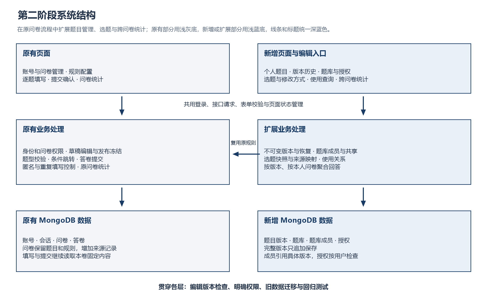
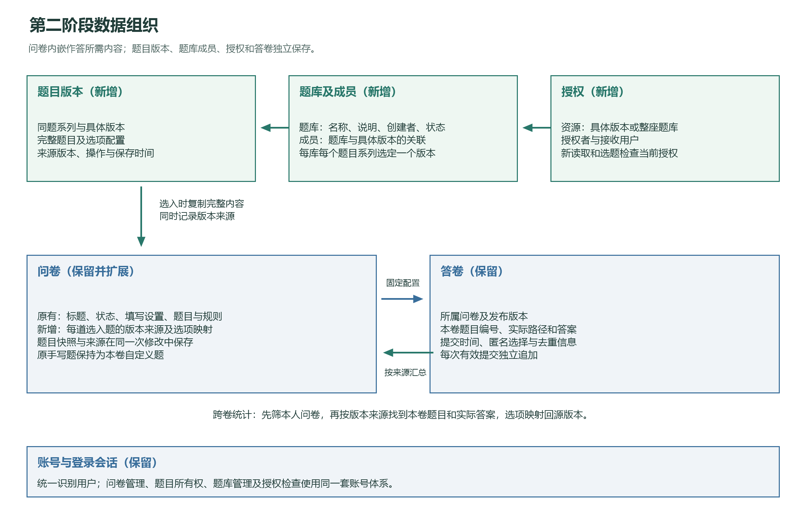

# MongoDB 问卷系统

使用 Python、FastAPI 和 MongoDB 实现的在线问卷系统，包含网页、后端接口和自动化测试。网页采用原生 HTML、CSS 和 JavaScript，由同一个 FastAPI 服务提供。

## 功能

- 注册、登录、退出，以及本人问卷的管理权限检查。
- 创建和编辑问卷，配置单选、多选、文本填空和数字填空，设置必答、数量、长度和数值范围。
- 根据单选、多选或数字答案配置跳转，按规则顺序使用第一条满足条件的规则。
- 发布分享链接，设置截止时间或手动关闭问卷；填写者登录后逐题作答。
- 校验答案、回退修改、确认提交，支持匿名、允许重复填写的设置、并发提交和网络重试确认。
- 查看整卷及单题统计，包括选项次数、填写内容、数字均值和答卷明细。
- 第二阶段增加个人题目的版本保存、历史与恢复，以及在问卷草稿中选用/替换具体版本。每份问卷保留独立快照；网页“我的题目”“题库”和原 `/docs` 均可操作。
- 支持题库管理、显式更新库内题目版本、按用户名共享具体版本或题库、从授权题目选题，以及版本/家族的问卷使用查询。共享只授读取和使用，撤销后已有问卷快照继续可用。
- 支持跨本人问卷的单题版本统计、数字频数分布、家族逐版汇总及填空内容分页。不同版本单独计算；撤权后仍可分析自己保留的选题快照。

## 系统框架



系统由页面交互、业务处理和 MongoDB 存储组成。页面负责问卷编辑、逐题填写和结果展示；后端统一处理登录权限、配置与答案校验、跳转、提交及统计；数据库保存最终配置和答卷。

图中蓝色部分是第一阶段的问卷流程，绿色部分是第二阶段增加的题目版本、题库、共享和跨问卷统计。新增操作共用原账号和题型校验，选题后仍由原填写、跳转与提交流程处理。

独立题目按版本保存，问卷保存选入时的完整内容及来源。源题修订、题库换版或撤销共享都保留已有问卷快照；跨问卷统计再根据来源找到本人问卷中的实际回答。

| 部分 | 主要职责 |
| --- | --- |
| 页面 | 创建者管理问卷、题目和题库；填写者按路径作答；展示统计和错误提示 |
| 业务处理 | 检查所有权和授权，管理问卷状态，校验配置及答案，处理版本和保存冲突 |
| 数据存储 | 内嵌保存问卷配置，独立保存答卷、题目版本、题库成员和授权 |

## 运行环境

| 项目 | 已验证环境 |
| --- | --- |
| 系统与终端 | Windows、PowerShell |
| Python | 3.13.9 |
| 数据库 | MongoDB 6.0.29 |
| 后端 | FastAPI、Pydantic、PyMongo，版本固定于 `requirements.txt` |
| 浏览器测试 | Playwright，默认使用本机 Microsoft Edge |

先安装 Python 和 MongoDB，确保终端中可以执行 `python` 和 `mongod`。前端随后端启动，无需额外构建。

## 安装与启动

### 1. 获取代码并安装依赖

```powershell
git clone https://github.com/joyce1116/DBMS_proj1.git
cd DBMS_proj1
python -m venv .venv
.\.venv\Scripts\python.exe -m pip install -r requirements.txt
```

后续命令均在项目根目录执行，直接使用虚拟环境中的 Python。

### 2. 终端 A：启动 MongoDB

```powershell
powershell -NoProfile -ExecutionPolicy Bypass -File .\scripts\start_mongo.ps1
```

脚本监听 `127.0.0.1:27018`，数据保存在 `.runtime/mongo-data`。保持此终端运行。

### 3. 终端 B：升级旧库、初始化并启动应用

当前问卷Schema为v4。**已有第一阶段或第二阶段第①部分的v3数据库**，须先停止应用、保持MongoDB运行，再执行以下显式迁移；新空库跳过迁移：

```powershell
.\.venv\Scripts\python.exe -B -X utf8 -m scripts.migrate_surveys_v4 --dry-run
.\.venv\Scripts\python.exe -B -X utf8 -m scripts.migrate_surveys_v4
```

迁移先保存原文备份与审计，仅补空的题目来源数组并更新结构版本；原问卷、题目、答卷、业务版本和时间保留。旧v1须依次v2→v3→v4，旧v2须v3→v4；不要对已升级库重跑更早版本的脚本。已经是v4时无需再次迁移。

```powershell
.\.venv\Scripts\python.exe -B -m scripts.init_db
.\.venv\Scripts\python.exe -B -m uvicorn app.main:app --host 127.0.0.1 --port 8000
```

浏览器打开 **http://127.0.0.1:8000/**。首次使用先注册账号。

结束时先在终端 B 按 `Ctrl+C` 停止应用，再在终端 A 按 `Ctrl+C` 停止 MongoDB。数据库文件会保留，下次启动后可以继续使用。

### 可选配置

默认配置可以直接运行。需要调整时，将 `.env.example` 复制为 `.env`，修改对应配置；环境变量优先于 `.env`。

| 配置项 | 默认值 | 用途 |
| --- | --- | --- |
| `MONGO_URI` | `mongodb://127.0.0.1:27018` | MongoDB 连接地址 |
| `MONGO_DB` | `survey_phase1` | 应用数据库名称 |
| `MONGO_TIMEOUT_MS` | `3000` | 数据库连接与请求超时，毫秒 |
| `SESSION_TTL_SECONDS` | `86400` | 登录会话有效期，秒 |

更换数据库端口时，同时调整启动脚本的 `-Port` 参数和 `MONGO_URI`。实际 `.env` 和本地数据目录已由 Git 忽略。

## 网页操作

1. 注册或登录，进入“我的问卷”，点击“创建问卷”。
2. 添加题目，设置选项、必答要求、选择数量、字数或数字范围。数字题勾选“只允许整数”后，上下限也须为整数。
3. 在“跳转规则”中选择来源题、条件和后方目标题或结束。规则按列表顺序判断。
4. 在“问卷设置”中保存匿名、重复填写和截止时间等设置，再发布问卷并复制分享链接。发布后题目和设置固定。
5. 在另一个浏览器或无痕窗口打开分享链接，使用填写账号登录，逐题作答并确认提交。回退修改会清除后续答案，重新计算答题路径。
6. 回到创建者页面，查看整卷统计、单题内容和答卷明细；需要停止收集时关闭问卷。

匿名填写时仍需登录，创建者查看匿名答卷时隐藏账号。提交结果未确认时，使用“重试确认提交”；刷新后可继续确认同一请求。

第二阶段新增操作：

1. 顶栏“我的题目”创建常用题目；打开具体版本，可创建新版本、恢复旧版、查看版本历史、授权管理和使用位置。恢复会另存新版本，历史一直保留。
2. “授权管理”输入已注册用户名；对方在“共享给我”中查看，只能读取和选用。新版本须另行授权；题库共享跟随题库当前成员和版本。
3. “题库”可创建、编辑和归档题库，把自己的题目版本加入，或显式更新同一题目系列在库中的版本。接收者通过“共享题库”查看。
4. 回到原问卷草稿，点击“从题库选题”，可切换我的题目、共享题目、我的题库、共享题库，选择具体版本。支持同题多卷、同卷重复选用。
5. 来源题有“替换来源”“修改方式”。只改本卷副本时，内容变化会解除来源；原作者也可创建题目新版本并换入本卷。已发布问卷仍冻结，换版须符合原有跳转规则。
6. 自定义题可“存入我的题目”。保存题目和关联本卷分两次请求；若关联因版本冲突或跳转规则失败，题目已保存、本卷保持原样，按提示刷新后选用，避免重复创建。
7. 题目详情和问卷来源卡片有“跨问卷统计”：仅统计自己已发布/关闭问卷；数值分布、有效填写内容分别分页，“查看各版本汇总”按版本分开统计。撤销共享后，保留来源的用户仍可统计自己的快照。

## 测试

### 常规测试

保持 MongoDB 运行，在新的终端执行：

```powershell
.\.venv\Scripts\python.exe -B -X utf8 -m pytest -q
```

覆盖账号、题目配置、跳转、校验、提交、权限、统计、并发和数据保留。默认排除浏览器用例。测试自行建立应用实例，使用随机命名的隔离数据库，并在结束后清理测试库。

### 离线测试

无需启动 MongoDB：

```powershell
.\.venv\Scripts\python.exe -B -X utf8 -m pytest -m "not integration and not browser" -q
```

### 浏览器测试

保持 MongoDB 运行，安装有 Microsoft Edge 时执行：

```powershell
.\.venv\Scripts\python.exe -B -X utf8 -m pytest tests/browser -m browser -q
```

浏览器用例自动启动临时 HTTP 服务，覆盖原网页流程，以及题目版本、共享/撤销、题库换版、选题、跨卷统计、分页与手机布局。原流程截图保存在 `.runtime/browser/`，第二阶段真实页面截图保存在 `backup_figure/stage2/`；截图只含随机隔离测试库的数据。`figures/` 保存报告和 README 使用的设计图，`backup_figure/` 归档旧版图片及测试截图。

使用 Playwright 自带的 Chromium 时执行：

```powershell
.\.venv\Scripts\python.exe -m playwright install chromium
$env:PLAYWRIGHT_CHANNEL = 'chromium'
.\.venv\Scripts\python.exe -B -X utf8 -m pytest tests/browser -m browser -q
```

常规及浏览器测试均不需要先启动终端 B。测试数据库连接使用 `TEST_MONGODB_URI`，默认也是 `mongodb://127.0.0.1:27018`；使用其他地址时，在运行测试的终端设置该环境变量。

最近一次完整功能回归：453 项常规测试、23 项浏览器测试通过，共 476 项；包含题目版本、选题、迁移、共享、跨本人问卷统计及新增网页流程。

## HTTP 演示

同时运行 MongoDB 和应用后，在第三个终端执行：

```powershell
.\.venv\Scripts\python.exe -B -X utf8 -m scripts.demo
```

演示会注册三个临时命名账号，创建包含四种题型和三类跳转规则的问卷，保存三份答卷，并检查匿名、重试、权限和统计。预期年龄均值为 18，文本内容为 2 条，最后关闭问卷并退出账号。

**每次演示都会在应用数据库中保留新增账号、问卷和答卷。**

## 接口与代码结构

应用运行后可访问：

| 地址 | 用途 |
| --- | --- |
| `http://127.0.0.1:8000/` | 用户网页 |
| `http://127.0.0.1:8000/docs` | 交互式 API 文档 |
| `http://127.0.0.1:8000/openapi.json` | 完整请求与响应结构 |
| `http://127.0.0.1:8000/health/ready` | 数据库就绪检查 |

业务接口除注册和登录外均要求访问令牌。调试接口时先登录，再在 API 文档的 `Authorize` 中填入返回的令牌。交互式 API 文档使用外部 CDN，用户网页使用本地静态资源。

```text
app/
  main.py          应用入口
  auth/            注册、登录、密码与会话
  surveys/         问卷、题目、跳转、答案校验与发布状态
  responses/       提交、答卷查询与统计
  questions/       独立题目、不可变版本、历史与恢复
  banks/           题库组织、版本成员及归档
  database/        MongoDB 连接、文档约束与索引
  core/            环境配置与时间处理
  web/             网页入口和静态资源
scripts/           MongoDB 启动、初始化与 HTTP 演示
tests/             模型、逻辑和 MongoDB 集成测试
  browser/         浏览器流程测试
requirements.txt   Python 依赖
pytest.ini         测试配置
.env.example       环境配置示例
```

## 常见问题

| 现象 | 检查方式 |
| --- | --- |
| 找不到 `mongod` | 检查 MongoDB 是否已安装，并将其可执行文件目录加入 PATH |
| 应用启动时连接数据库失败 | 确认终端 A 正在运行，连接地址与端口和 `MONGO_URI` 一致 |
| 集成测试连接数据库失败 | 检查 MongoDB 和测试终端的 `TEST_MONGODB_URI` |
| 浏览器测试找不到 Edge | 按上面的 Chromium 命令安装浏览器并切换通道 |
| 网页无法加载接口数据 | 从 `http://127.0.0.1:8000/` 打开网页，并检查终端 B 的输出 |

## 系统与设计说明

### 系统说明

系统分为页面交互、业务处理和数据保存三部分。页面收集输入并显示结果，后端统一检查权限、问卷状态、答案和跳转规则，MongoDB 保存账号、问卷及答卷。

整体流程如下：

1. 创建者登录并建立草稿，配置题目、跳转规则和填写限制，保存后发布分享链接。
2. 填写者通过链接登录，逐题作答。后端校验已有答案并决定下一题，页面显示对应题目或错误提示。
3. 填写者确认提交，后端检查收集状态和填写次数，保存实际答题路径及答案并返回回执。
4. 创建者查看统计和答卷明细，也可手动关闭问卷；到达截止时间后停止接受新答卷。

可复用题目的流程是“保存个人版本 → 整理题库或授权共享 → 草稿选择具体版本 → 发布填写 → 查询使用位置及跨卷统计”。题目修订和问卷换版分别操作，已经发布的问卷保持原内容。

| 用户身份 | 可以操作的范围 |
| --- | --- |
| 问卷创建者 | 管理自己的草稿、发布和关闭问卷，查看本卷答卷与统计 |
| 题目或题库所有者 | 管理本人版本、历史、恢复、题库成员及授权；题目作者可查询使用位置 |
| 共享接收者 | 读取授权版本、选入自己的问卷，查看自己问卷中的回答统计 |
| 填写者 | 登录后通过分享链接填写；匿名设置决定创建者看到的身份信息 |

这些身份可以由同一账号承担。每次操作按资源检查所有权和当前授权。

### 数据库设计



问卷内嵌题目、选项和跳转，答卷独立追加。题目版本完整保存每次修订，题库成员引用具体版本，授权记录接收用户。选题时把内容和来源一起保存到问卷，填写读取本卷快照，跨卷统计使用来源关联答案。

| 集合 | 保存内容 |
| --- | --- |
| `users` | 用户名、密码哈希和注册时间 |
| `sessions` | 所属账号、登录凭据摘要和有效期 |
| `surveys` | 创建者、标题、填写设置、状态、编辑版本、内嵌题目/选项/跳转，以及选题版本来源和选项映射 |
| `submissions` | 所属问卷、填写账号、匿名选择、请求标识、提交时间、实际路径和答案 |
| `question_versions` | 独立题目的版本家族、父版本、完整配置、所有者及创建/派生/恢复操作 |
| `question_banks` | 题库所有者、名称、说明、编辑版本和归档状态 |
| `question_bank_entries` | 题库中每个题目家族当前选用的具体版本 |
| `question_grants` | 按现有用户授予精确版本或题库的读取/使用权 |

会话关联账号，问卷关联创建者，答卷关联问卷和填写者。题目与选项使用固定编号，规则和答案通过这些编号找到对应内容。

问卷配置需要整体读取和编辑，因此将题目、选项和规则放入同一文档，减少逐项拆成关系表后的关联读取和拼装。答卷随提交持续增加，独立保存后，每次填写只需追加一份答卷。

MongoDB 的嵌套文档和数组适合表达多种题型及答案。文档校验约束保存格式，单文档原子更新保护草稿编辑，唯一索引执行用户名唯一、请求去重和填写限次，聚合管道生成统计。

一版题目保存完整内容，历史以独立文档追加；题库成员和授权单独保存，随使用增长。选入问卷时复制完整题目并建立本卷选项到源选项的映射，跨卷统计通过这条映射关联答案。题目系列标识同一道题，具体版本固定内容，本卷题号用于跳转和作答。

主要约束如下：

| 约束 | 作用 |
| --- | --- |
| 规范化用户名唯一 | 并发注册时保持账号名称唯一 |
| 同题目系列、版本号唯一 | 多个请求派生版本时避免重号 |
| 同题库、题目系列唯一 | 每个系列在一座库中选择一个当前版本 |
| 同资源、接收用户唯一 | 重复授权保留同一条记录 |
| 同账号、问卷、请求标识唯一 | 重试返回原提交结果 |
| 禁止重复答卷的账号、问卷部分唯一索引 | 并发下执行填写限次 |

MongoDB 使用严格文档校验，程序进一步检查选项归属、上下限、来源映射和规则引用。会话由到期索引清理，请求仍主动校验有效期。结构升级通过预检、原文备份、迁移和审计完成；当前问卷结构为第四版，编辑版本与题目内容版本分别管理。

### API 说明

下表列出主要业务接口。`{id}` 为问卷编号，`{qid}` 为题目编号，`{share_id}` 为分享标识；完整请求和响应结构见运行后的 `/openapi.json`。

| 方法与路径 | 用途及主要输入 |
| --- | --- |
| `POST /api/auth/register`；`POST /api/auth/login` | 提交用户名和密码，注册或获取登录令牌 |
| `GET/POST /api/surveys` | 列出本人问卷或创建草稿 |
| `GET/PATCH /api/surveys/{id}` | 读取详情，或携带编辑版本修改问卷设置 |
| `POST /api/surveys/{id}/questions` | 携带当前编辑版本添加题目；指定题目路径支持修改和删除 |
| `PUT /api/surveys/{id}/rules` | 提交当前编辑版本和跳转规则列表 |
| `POST /api/surveys/{id}/publish`；`POST /api/surveys/{id}/close` | 携带当前编辑版本发布或关闭问卷 |
| `GET /survey/{share_id}` | 打开填写入口，登录后获取问卷内容 |
| `POST /survey/{share_id}/validate` | 提交题目编号和答案，执行单题校验 |
| `POST /survey/{share_id}/navigate` | 提交问卷版本和已有答案，取得答题路径及下一题 |
| `POST /survey/{share_id}/responses` | 提交问卷版本、请求标识、匿名选择和完整答案，取得回执 |
| `GET /api/surveys/{id}/responses` | 创建者分页读取答卷 |
| `GET /api/surveys/{id}/statistics`；`GET /api/surveys/{id}/statistics/{qid}` | 查看整卷统计或单题统计与填空内容 |
| `GET/POST /api/questions`；`GET /api/questions/{version_id}` | 创建个人题目版本、列出本人所有版本或读取具体版本 |
| `GET /api/questions/{version_id}/history`；`POST .../versions`；`POST .../restore` | 读取版本历史、派生或恢复为新的版本 |
| `POST /api/surveys/{id}/question-selections`；`PUT .../question-selections/{qid}` | body提供version_id，query提供expected_revision，添加或显式替换草稿选题 |
| `GET/POST /api/question-banks`；`GET/PATCH/DELETE /api/question-banks/{bank_id}` | 题库本人/共享列表、创建、元数据CAS更新与软归档 |
| `GET/POST /api/question-banks/{bank_id}/entries`；`PUT/DELETE .../entries/{family_id}` | 成员分页、添加、expected_version_id换版或移除 |
| `GET/POST /api/questions/{version_id}/grants`；`DELETE .../grants/{user_id}` | 按username授精确版本、列授权和幂等撤销；题库路径同样支持grants |
| `GET /api/shared-questions` | 分页发现直接共享或共享题库中的当前版本，多授权去重 |
| `GET /api/questions/{version_id}/usage?scope=version` | 原题主查引用问卷；scope=family包含同家族各版，他人问卷仅返回受限摘要 |
| `GET /api/questions/{version_id}/statistics` | 汇总该版本在本人已发布/关闭问卷中的作答；数字频数分页 |
| `GET /api/questions/{version_id}/statistics/family`；`GET .../statistics/contents` | 题主逐版汇总分页；本人问卷text/number内容分页，均不返回账号身份 |

常见错误状态：401 未登录，404 资源不存在或无管理权限，409 版本或重复冲突，410 问卷关闭或截止，422 配置或答案错误，503 数据库不可用。

**认证与分页。** 登录成功后取出 `access_token`，业务请求携带 `Authorization: Bearer <登录令牌>`。请求和响应使用 JSON。普通列表通过 `offset`、`limit` 分页，每页1～100条，返回当前页及总数；题目列表包含本人保存的全部版本。

**选题示例。** 将下面的问卷编号、题目版本编号和编辑版本替换为当前读取的值。假设草稿编辑版本为4：

```http
POST /api/surveys/{id}/question-selections?expected_revision=4
Authorization: Bearer <登录令牌>
Content-Type: application/json

{"version_id":"<题目版本编号>"}
```

成功返回201及更新后的问卷详情，编辑版本增加为5，题目快照和来源一起保存。若另一页面已经修改草稿，返回409，刷新详情后重新处理。替换既有选题使用对应的 PUT 路径，并指定本卷题号。

**共享与统计。** 授权接口提交 `{"username":"team_member"}`，接收用户须已注册。首次授权返回201，重复授权返回200。接收者从共享列表读取并选题。查看该版本统计时，可调用：

```http
GET /api/questions/{version_id}/statistics?offset=0&limit=20
Authorization: Bearer <登录令牌>
```

统计返回本人问卷中的计数、选项次数或数字均值与极值，数字频数按页返回。填写内容通过 `/statistics/contents` 单独分页；整个题目系列的逐版结果通过 `/statistics/family` 读取，仅题目作者可用。分享链接读取 JSON 时携带 `Accept: application/json` 和登录令牌。

### 关键逻辑说明

**编辑与发布：** 草稿保存时同时检查创建者、草稿状态和编辑版本，成功后版本递增。同一旧版本的后续保存提示冲突。发布后固定题目、规则和填写设置，使各份答卷对应一致的问卷内容。

**版本与快照：** 新建、修改和恢复都保存独立版本，记录真实来源。选入草稿时生成本卷题号及选项编号；同系列换版保留仍存在选项的映射。本地编辑实际改变内容后解除来源，继续复用时则保存新版本再选入。快照与来源在同一次问卷修改中保存。

**跳转与校验：** 后端从第一题开始，检查必答、选项归属、数量、字数和数值范围，再按顺序采用第一条满足条件的规则。未命中时进入下一题，命中时转到后方题目或结束。跳过的必答题可省略；回退修改会清除后续答案，最终提交重新计算路径并拒绝旧分支答案。

**提交与重试：** 提交流程为“核对登录及历史请求 → 检查开放状态、版本和匿名设置 → 重算路径并校验答案 → 检查填写次数 → 确认受理 → 保存答卷 → 返回回执”。相同请求标识和内容再次到达时返回原回执，内容改变则提示冲突。网络故障后保留原标识和内容重试，确认同一次提交的结果。

**匿名与并发：** 匿名答卷在创建者页面隐藏账号，内部保留账号关联，用于限次和重试。数据库唯一约束处理同时到达的提交。受理与关闭操作在同一问卷记录上确定先后：先受理的请求可继续保存，先关闭或已经截止时拒绝新请求。

**统计：** 按问卷筛选已保存答卷，再按题目汇总回答份数和选项次数，分页展示填空内容，并计算有效数字的均值。留空和被跳过的题目不参与均值计算。

**题库与共享：** 题库成员指向固定版本，由所有者显式更新，只允许加入本人版本。具体版本授权只覆盖当前版本；题库授权随当前成员和版本变化。多个有效授权可以并存，撤销一路后其余授权继续生效。撤销、移除或归档后，已有问卷快照继续保留。使用查询显示问卷份数和引用次数，他人问卷只提供摘要。

**跨卷单题统计：** 通过来源把不同卷的本地题目和选项映射回具体版本，纳入本人已发布或关闭的问卷，包含截止数据。问卷数、引用次数、答卷份数、经过次数、有效回答分别计数。例如同版在一卷出现两次，一份答卷两次都回答，则计1份答卷、2次有效回答。跳过不计经过，选答留空只计经过；数字对全部有效答案计算均值。各版本独立展示，撤权后有本人来源记录的快照仍可查询自身精确统计。

**部分成功处理：** 创建新版本和换入本卷分两次请求。若第一步成功、第二步因规则或编辑冲突失败，新版已保留、原问卷保持。界面显示结果，锁定已保存输入并提示刷新后选择已有新版；原有选项规则需要通过换版校验。